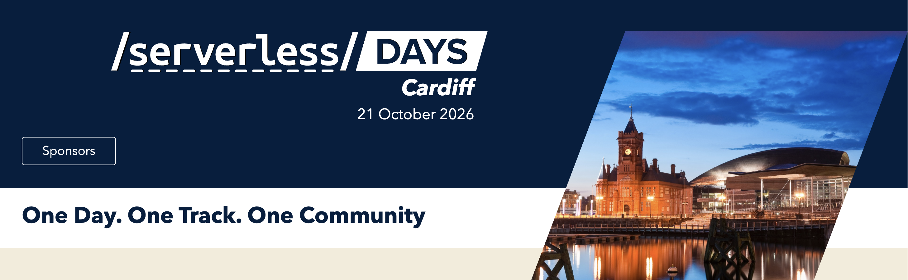
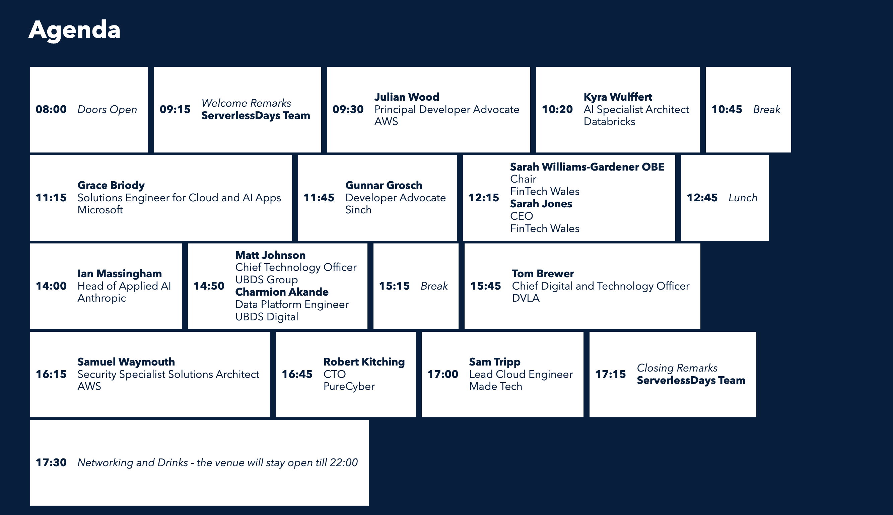
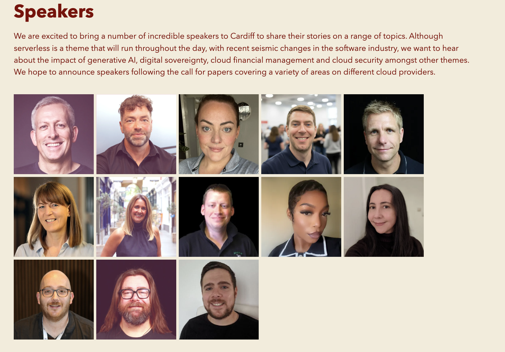

# ServerlessDays Cardiff 2026 — materials

One day, one track, one community. Serverless runs through the whole day, alongside generative AI, digital sovereignty, cloud financial management and cloud security.

- **Workshop:** Oct 20, 2026
- **Conference:** Oct 21, 2026

## Day 1 — workshop, Oct 20

| folder | topic | speakers |
|--------|-------|----------|
| [01_workshop](./01_workshop/) | AWS Lambda MicroVMs: running user-written or AI-generated code securely in isolated sessions (photos only) | Mike Hume, Pete Davis, Julian Wood (AWS) |

The workshop notes and code are in a separate repo: https://github.com/leva13007/MicroVMs_Workshop

## Day 2 — conference, Oct 21

The **slot** column is the time from the official agenda. The **rec** column is the time the actual recording started. The running order changed on the day, and two speakers were replaced at short notice.

| folder | slot | rec | speaker | topic |
|--------|------|-----|---------|-------|
| [00](./00/) | 09:15 | 09:33 | ServerlessDays Team | Welcome remarks |
| [02_Julian_Wood](./02_Julian_Wood/) | 09:30 | 09:35 | **Julian Wood**, Principal Developer Advocate, AWS | Morning keynote: how AWS Lambda has evolved |
| [03_Kyra_Wulffert](./03_Kyra_Wulffert/) | 10:20 | 10:28 | **Kyra Wulffert**, AI Specialist Architect, Databricks | AgentOps: operating agentic AI systems |
| [04_Grace_Briody](./04_Grace_Briody/) | 11:15 | 11:44 | **Grace Briody**, Solutions Engineer for Cloud and AI Apps, Microsoft | Using AI across the whole software delivery lifecycle, not just for writing code |
| [05_FinTech Wales](./05_FinTech%20Wales/) | 12:15 | 12:20 | **Sarah Williams-Gardener OBE**, Chair, and **Sarah Jones**, CEO, FinTech Wales | Panel: AI in financial services, from experimentation to production |
| — | 14:00 | — | ~~Ian Massingham~~, Head of Applied AI, Anthropic | Cancelled because the speaker was ill |
| [06_UBDS_Digital](./06_UBDS_Digital/) | 14:50 | 13:58 | **Matt Johnson**, CTO, UBDS Group, and **Charmion Akande**, Data Platform Engineer, UBDS Digital | Digital sovereignty from theory to implementation |
| [07_Gunnar_Grosch](./07_Gunnar_Grosch/) | 11:45 | 14:22 | **Gunnar Grosch**, Developer Advocate, Sinch | Building a conversational agent with Lambda durable functions |
| [08_Tom_Brewer](./08_Tom_Brewer/) | 15:45 | 15:46 | **Tom Brewer**, Chief Digital and Technology Officer, DVLA | Transforming the DVLA despite the limits of its legacy systems |
| [09_Samuel_Waymouth](./09_Samuel_Waymouth/) | 16:15 | 16:08 | **Samuel Waymouth**, Security Specialist Solutions Architect, AWS | Governing autonomous AI agents without slowing teams down |
| [10_Made_Tech](./10_Made_Tech/) | 17:00 | 17:01 | **Jim**, Head of Technology, Made Tech (standing in for Sam Tripp) | Skills and agents for each job family to help teams become AI-first |
| [11_Robert_Kitching](./11_Robert_Kitching/) | 16:45 | 17:14 | **Robert Kitching**, CTO, PureCyber | AI in the Security Operations Centre, given without slides |

### Official agenda

### Speakers

## What's in each folder

- `audio/`: recordings in `.m4a`. Some talks are split into two recordings.
- `transcripts/`: a `.txt` and a `.srt` for each recording. These are unedited machine transcriptions, so check names and terms against the slide photos.
- `photo/`: photos of the slides and the stage.

Files are named `YYYY-MM-DD_HHMM_<source>.<ext>`, so sorting by name gives chronological order.
